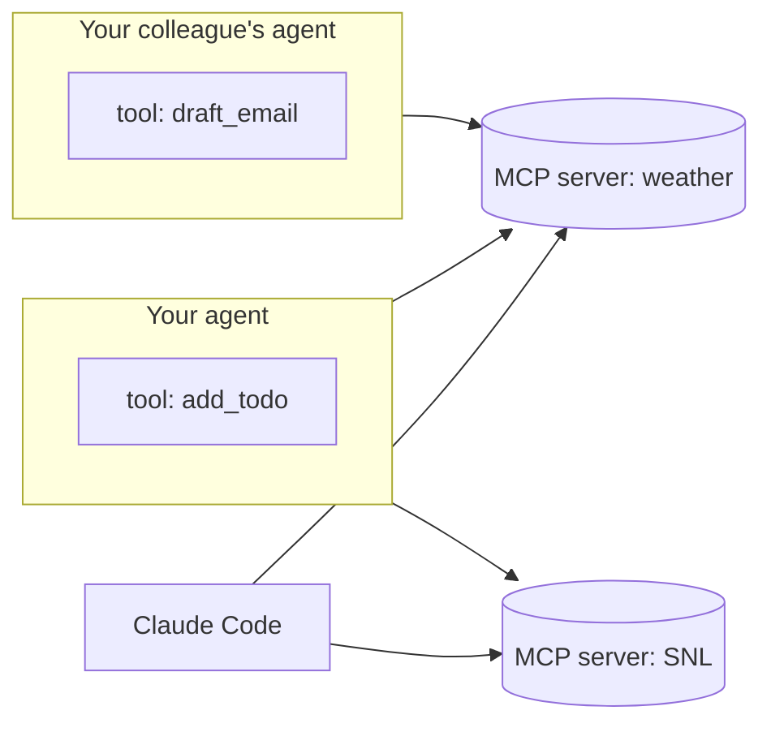

# Claude Agent SDK Workshop

## How to Run

1. Create a virtual environment in the `3-agents` folder:

   ```bash
   cd 3-agents
   ```

   ```bash
   python -m venv venv
   ```

   or

   ```bash
   python3 -m venv venv
   ```

2. Activate the virtual environment:

   ```bash
   source venv/bin/activate
   ```

3. Install dependencies:

   ```bash
   pip install -r requirements.txt
   ```

   The Agent SDK comes with Claude Code bundled inside, so the download is bigger than usual. You don't need Node.js or a separate Claude Code install.

4. Create a `.env` file with your Anthropic API key:

   ```
   ANTHROPIC_API_KEY=your_anthropic_api_key_here
   ```

5. Run the agent:
   ```bash
   python agent.py
   ```
   Type 'quit', 'exit', or 'bye' to stop the agent.

## From Tool Loop to Agent

In the last workshop you built the agent loop yourself: call the API, check for `tool_use`, run the tools, send back `tool_result` blocks, repeat. That's all an agent is, but it's a lot of plumbing to write every time.

The **Claude Agent SDK** is the agent loop that powers Claude Code, packaged as a Python library. It runs the loop, executes the tools, keeps the conversation, and manages the context window. It also comes with Claude Code's built-in tools (web search, reading and editing files, running commands) and can connect to MCP servers. You describe **what** your agent is, and the SDK runs it:

```python
options = ClaudeAgentOptions(
    model="claude-opus-5-5",
    system_prompt="You are a travel planner for Norway.",  # who the agent is
    tools=["WebSearch"],                                   # built-in tools it can see
    allowed_tools=["WebSearch"],                           # tools it may run without asking
    mcp_servers={},                                        # more tools: yours and other people's
)

async with ClaudeSDKClient(options=options) as client:
    await client.query("What's on at the Oslo Opera House this week?")
    async for message in client.receive_response():
        print(message)
```

`ClaudeSDKClient` keeps the conversation going between questions, so there's no `messages` list to manage anymore. For one-off tasks there's also `query()`, which runs a single prompt and returns.

While the agent works, you get a stream of messages: `AssistantMessage` holds Claude's text and tool calls (`TextBlock`, `ToolUseBlock`), `UserMessage` holds the tool results, and every answer ends with a `ResultMessage` with the cost and how many turns the agent needed. The `print_message` function in `agent.py` shows the interesting parts.

**Resources:** [Agent SDK overview](https://code.claude.com/docs/en/agent-sdk/overview) · [Python reference](https://code.claude.com/docs/en/agent-sdk/python)

## Tool or MCP Server?

There are two ways to give your agent new abilities, and choosing between them is the most important design decision in this workshop.

- A **tool** is a Python function inside your agent. Only this agent can use it, and it can reach anything in your program: variables, the current user, your app's state.
- An **MCP server** is a separate service that exposes tools over the [Model Context Protocol](https://modelcontextprotocol.io/docs/getting-started/intro). Any MCP client can subscribe to it: your agent, your colleague's agent, Claude Code, Cursor, Claude Desktop. Build it once, use it everywhere.



|                    | Tool (`@tool`)                                   | MCP server                                                    |
| ------------------ | ------------------------------------------------ | ------------------------------------------------------------- |
| Runs               | Inside your agent's process                      | As its own process or service, locally or remotely            |
| Who can use it     | Only this agent                                  | Any MCP client                                                |
| Has access to      | Your program's state                             | Only what's sent in the request                               |
| Owned and deployed | Together with the agent                          | On its own, often by the team that owns the data              |
| Good for           | Logic that only makes sense for this agent's job | Shared capabilities: an API, a database, a company system     |
| Examples           | This chat's todo list, "ask before sending"      | Weather, SNL, the client's ticket system or product catalogue |

**Rule of thumb:** if a second agent would want it, or another team owns the system behind it, make it an MCP server. If it only makes sense inside this agent, make it a tool.

Fun fact: in the Agent SDK, your custom tools are MCP too. `create_sdk_mcp_server()` wraps them in a small MCP server that runs inside your process and only your agent can see. The protocol is the same. What differs is where the code runs and who can use it.

## Workshop Tasks

### Task 1: Create Your Agent

Your agent runs, but it's a blank slate: a generic assistant that only knows its training data. Let's give it a job and its first tools. 🛠️

**Your Mission:**
Turn the starter in `agent.py` into an agent with a purpose that can look things up on the web.

**Steps:**

1. Run `python agent.py` and ask something current, like "What's the weather in Oslo right now?". It can't know.
2. Change `SYSTEM_PROMPT` to give your agent a job. Pick something you want to keep building on in the next tasks:
   - 🧳 **Trip planner** for weekend trips in Norway
   - 💼 **Consultant's assistant** that helps you plan your workday
   - 🏢 **Domain expert** for the domain of the client you work for
   - 🎲 Or anything else you can imagine
3. Give it Claude Code's web tools: add `"WebSearch"` and `"WebFetch"` to both `tools` and `allowed_tools`
4. Ask your question again and watch the 🔧 lines: the agent decides on its own when to search, which pages to read, and when it knows enough
5. Ask a follow-up question. The agent remembers the conversation without you sending any history

**Test Ideas:**

- "What's happening in Oslo this weekend?"
- "Summarize the latest release notes for Python"
- "Find three good lunch places near Akershusstranda 21 and tell me what they're known for"

**Resources:** [Agent SDK quickstart](https://code.claude.com/docs/en/agent-sdk/quickstart) · [Configure permissions](https://code.claude.com/docs/en/agent-sdk/permissions)

**Hints:**

- `tools` decides which built-in tools the agent can **see**. `allowed_tools` decides which tools may **run** without asking. In the default permission mode, every other tool call is denied, so you're always in control of what your agent can do
- The built-in tools are the same ones Claude Code uses: `Read`, `Write`, `Edit`, `Glob`, `Grep`, `Bash`, `WebSearch`, `WebFetch` and more. We stick to the web tools for now so the agent can't touch your files
- Look at the 📊 line after each answer. One question can take several turns, and every turn costs tokens
- Compare with `solution.py` from workshop 2: no loop, no `tool_result` blocks, no history list

### Task 2: Give Your Agent Its Own Tool

Web search is the same for every agent. Now let's build a tool that belongs to **your** agent: a todo list it keeps for you during the conversation. ✅

**Your Mission:**
Create custom tools with the `@tool` decorator that let the agent add items to and list items from a todo list.

**Why a tool and not an MCP server?** The todo list is a Python list inside your agent. It lives and dies with this chat, and no other agent should see it. That makes it a perfect tool.

**Steps:**

1. Create an empty list `todos = []` in `agent.py`
2. Define a tool for adding items:

   ```python
   from claude_agent_sdk import create_sdk_mcp_server, tool

   @tool("add_todo", "Add an item to the user's todo list", {"item": str})
   async def add_todo(args):
       todos.append(args["item"])
       return {"content": [{"type": "text", "text": f"Added '{args['item']}'"}]}
   ```

3. Define a `list_todos` tool yourself (and `complete_todo` if you want)
4. Wrap your tools in a server: `todo_server = create_sdk_mcp_server(name="todo", tools=[add_todo, list_todos])`
5. Add `"todo": todo_server` to `mcp_servers` and `"mcp__todo__*"` to `allowed_tools`
6. Test it with your assistant

**Example Output:**

```
🫵 User: Remind me to book a meeting room and to buy coffee
🔧 Calling tool: mcp__todo__add_todo with arguments: {'item': 'Book a meeting room'}
🔧 Calling tool: mcp__todo__add_todo with arguments: {'item': 'Buy coffee'}
🤖 Agent: Added both to your list: book a meeting room and buy coffee.
📊 2 turn(s), $0.0421
```

**Resources:** [Give Claude custom tools](https://code.claude.com/docs/en/agent-sdk/custom-tools)

**Hints:**

- Tools are named `mcp__<server>__<tool>`, where `<server>` is the key you use in `mcp_servers`. `mcp__todo__*` allows every tool on the `todo` server
- The input schema `{"item": str}` is turned into a JSON schema for you. For optional parameters or enums, pass a full JSON Schema dict instead
- Return an error with `{"content": [...], "is_error": True}`, and Claude will read your message and try something else
- If you see a `ToolSearch` call, that's tool search: Claude starts out seeing only the tool names, and loads a tool's full schema when it needs it
- More ideas: port `send_slack_message` from workshop 2, or a tool that reads something only your app knows, like the current user

### Task 3: Connect Your Agent to MCP Servers

Time to subscribe to tools someone else built. We have made a weather MCP server for you, and there are plenty of public ones on the internet. 🌦️

**Your Mission:**
Connect your agent to the weather MCP server running on your machine and to a public MCP server, and see that other clients can use the same server.

**Steps:**

1. Look at `weather_server.py`. It has two tools: `find_place` (Kartverket's place names) and `get_forecast` (MET Norway, the data behind yr.no). Notice how the docstrings and type hints become the tool descriptions, and how the forecast is trimmed before it's returned
2. Start the server in a **second terminal** (remember to activate the venv there too):

   ```bash
   python weather_server.py
   ```

   It runs on `http://127.0.0.1:8000/mcp`

3. Connect your agent to it:

   ```python
   mcp_servers={
       "todo": todo_server,
       "weather": {"type": "http", "url": "http://127.0.0.1:8000/mcp"},
   },
   ```

   and add `"mcp__weather__*"` to `allowed_tools`

4. Ask "Do I need an umbrella in Bergen tomorrow?" and watch the agent chain `find_place` → `get_forecast`
5. Now connect a second client to the **same running server**:
   - **MCP Inspector:** run `npx -y @modelcontextprotocol/inspector`, choose Streamable HTTP and connect to `http://127.0.0.1:8000/mcp`
   - **Claude Code:** run `claude mcp add --transport http weather http://127.0.0.1:8000/mcp` and ask Claude Code about the weather

   Two different agents, one server, no copied code. That's the point of MCP.

6. Find a public MCP server and add it the same way. [DeepWiki](https://docs.devin.ai/work-with-devin/deepwiki-mcp) answers questions about any public GitHub repo, and needs no login:

   ```python
   "deepwiki": {"type": "http", "url": "https://mcp.deepwiki.com/mcp"},
   ```

   Allow `"mcp__deepwiki__*"` and try "How does anthropics/claude-agent-sdk-python start the Claude Code CLI?"

**Other public MCP servers without login:**

- [Microsoft Learn](https://learn.microsoft.com/en-us/training/support/mcp): `https://learn.microsoft.com/api/mcp` for Microsoft and Azure docs
- [Context7](https://context7.com): `https://mcp.context7.com/mcp` for up-to-date docs for thousands of libraries
- Browse more in the [MCP Registry](https://registry.modelcontextprotocol.io)

**Resources:** [Connect MCP servers](https://code.claude.com/docs/en/agent-sdk/mcp) · [MCP Python SDK](https://py.sdk.modelcontextprotocol.io/v2/)

**Hints:**

- The agent says it has no weather tools? Check that the server is running. `await client.get_mcp_status()` tells you which servers connected, see `print_mcp_status` in `solution.py`
- The agent can also start a local server itself, over stdio instead of HTTP: change the last line of the server to `mcp.run()` and connect with `{"command": sys.executable, "args": ["weather_server.py"]}`. Then every agent starts its own copy, while over HTTP they all share one running server
- `agent.py` uses `strict_mcp_config=True` so your agent only sees the servers you list, not the ones you have set up in your own Claude Code

### Task 4: Build Your Own MCP Server

Now it's your turn to build the kind of server other agents subscribe to. Pick an API and make it available to every agent at Bekk (or at your client). 🚀

**Your Mission:**
Create an MCP server that wraps an existing API, test it, and connect your agent to it.

**Pick an API:**

| API                                                                          | What you get                                     | Try it                                                                                                                                                                                                                  |
| ---------------------------------------------------------------------------- | ------------------------------------------------ | ----------------------------------------------------------------------------------------------------------------------------------------------------------------------------------------------------------------------- |
| SNL                                                                          | Store norske leksikon, the Norwegian encyclopedia | [search](https://snl.no/api/v1/search?query=Henrik%20Ibsen&limit=3), then [an article](https://snl.no/Henrik_Ibsen.json)                                                                                                |
| [SSB](https://www.ssb.no/en/api/pxwebapi)                                    | Statistics Norway: population, prices, names     | [Population of Oslo and Bergen](<https://data.ssb.no/api/pxwebapi/v2/tables/11342/data?lang=en&valueCodes[Region]=0301,4601&valueCodes[ContentsCode]=Folkemengde&valueCodes[Tid]=top(1)&outputFormat=json-stat2>)        |
| [Entur](https://developer.entur.org/pages-journeyplanner-journeyplanner)     | Public transport: stops, departures, trips       | [Find a stop](https://api.entur.io/geocoder/v1/autocomplete?text=Jernbanetorget&layers=venue), then departures with the GraphQL API                                                                                     |
| [Brønnøysundregistrene](https://data.brreg.no/enhetsregisteret/api/dokumentasjon/no/index.html) | Companies: org number, employees, address, industry | [Search for Bekk](https://data.brreg.no/enhetsregisteret/api/enheter?navn=bekk%20consulting)                                                                                                                 |
| [Norges Bank](https://app.norges-bank.no/query/)                             | Exchange rates                                   | [USD to NOK](https://data.norges-bank.no/api/data/EXR/B.USD.NOK.SP?format=sdmx-json&lastNObservations=1)                                                                                                                |
| [Kartverket](https://ws.geonorge.no/adresser/v1/)                            | Addresses and their coordinates                  | [Bekk's office](https://ws.geonorge.no/adresser/v1/sok?sok=Akershusstranda%2021&treffPerSide=1)                                                                                                                         |
| Bekk or your client                                                          | Something internal                               | Which system would several agents or teams at your client want to use? A ticket system, a product catalogue, internal docs, an open data API they publish?                                                              |

**Steps:**

1. Create `my_server.py`. Copying `weather_server.py` is a good start
2. Write 1-3 tools with `@mcp.tool()`
3. Run it on its own port, so it can run next to the weather server: `mcp.run(transport="streamable-http", port=8001)`
4. Test your tools in the MCP Inspector before you give them to an agent
5. Connect your agent to `http://127.0.0.1:8001/mcp` and allow its tools
6. Ask questions that make the agent combine your server with the others

**Test Ideas:**

- "Who was Henrik Ibsen, and what's the weather in Skien today?" (SNL + weather)
- "How many people live in Tromsø, and how cold is it there right now?" (SSB + weather)
- "When does the next metro leave Jernbanetorget, and will I get wet on the way?" (Entur + weather)

**Resources:** [MCP Python SDK](https://py.sdk.modelcontextprotocol.io/v2/) · [Build an MCP server](https://modelcontextprotocol.io/docs/getting-started/intro)

**Hints:**

- The function name, docstring and parameters are all the agent knows about your tool. Say what it does, when to use it, and which units and formats it uses
- Return only what the agent needs. API responses are often huge, and everything you return ends up in the agent's context window (see how `get_forecast` trims MET's response)
- For failures you expect, `raise ToolError("...")` with a message that helps the agent try again. Other exceptions only reach the agent as "Error executing tool"
- Some APIs need a header to identify you: MET wants a `User-Agent`, and Entur wants `ET-Client-Name` (e.g. `bekk-agentworkshop`)
- Does the API need a secret? Keep it in the MCP server's environment. The agents using your server never see it
- Stuck? `solution_server.py` wraps SNL

### Task 5: Play Around and Find Out 🧪

You have an agent with built-in tools, its own tools and MCP servers. That's the whole foundation. The rest of the workshop is yours: pick something, try it, break it, and find out what agents are good (and bad) at. Claude Code runs on the same agent loop as your agent, so it's a great pair programmer for this.

**Ideas:**

- 🤝 **Share your MCP server:** Run it with `mcp.run(transport="streamable-http", host="0.0.0.0", port=8001)` and let the people around you connect to `http://<your-ip>:8001/mcp`. How many servers can one agent use?
- 🖥️ **Use your server elsewhere:** Connect it to Claude Code, Cursor or Claude Desktop
- 📁 **Let it work with files:** Give the agent `Read`, `Write`, `Edit` and `Glob`, point `cwd` to a sandbox folder, and ask for your permission in the terminal with `can_use_tool`. [Docs](https://code.claude.com/docs/en/agent-sdk/user-input)
- 🪝 **Hooks:** Log every tool call, or block certain calls with a `PreToolUse` hook. [Docs](https://code.claude.com/docs/en/agent-sdk/hooks)
- 🧑‍🤝‍🧑 **Subagents:** Give your agent a specialist to delegate to, like a researcher that only has web tools. [Docs](https://code.claude.com/docs/en/agent-sdk/subagents)
- 📚 **Skills:** Write a `SKILL.md` that teaches your agent a workflow. [Docs](https://code.claude.com/docs/en/agent-sdk/skills)
- 🧱 **Structured output:** Make the agent return JSON that matches a schema. [Docs](https://code.claude.com/docs/en/agent-sdk/structured-outputs)
- 💾 **Sessions:** Continue a conversation after restarting the agent. [Docs](https://code.claude.com/docs/en/agent-sdk/sessions)
- 💸 **Guardrails:** Cap a runaway agent with `max_turns` and `max_budget_usd`
- 🏢 **Build for your client:** What agent would actually help the people at your client, and which MCP servers would it need?
